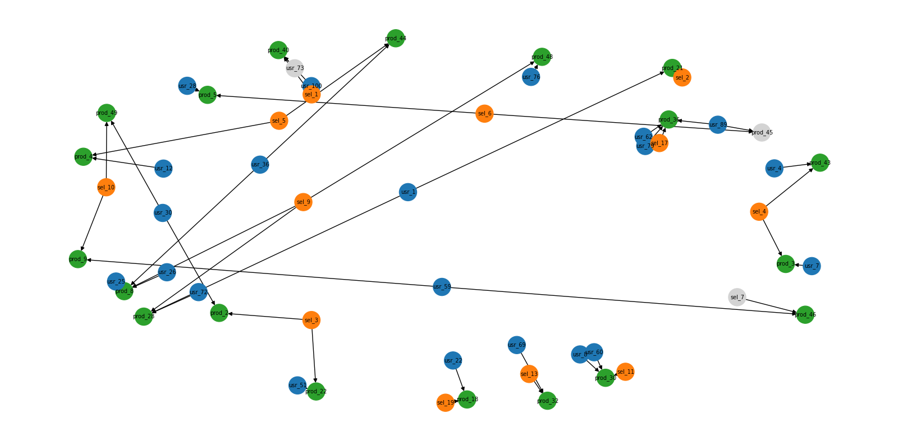

# Simulation d'une marketplace en streaming (PySpark + GraphFrames)

Pipeline de traitement de données en temps réel qui simule l'activité d'une plateforme de petites annonces de type Leboncoin : des utilisateurs consultent, aiment ou achètent des produits mis en vente par des vendeurs. Les événements sont traités en streaming, modélisés sous forme de graphe, puis visualisés dynamiquement.



> Projet de groupe (3 personnes). **Ma contribution :** conception du générateur d'événements (`generator.py`) et du dashboard de visualisation dynamique avec accumulation progressive du graphe (`dashboard_live.py`).

## Architecture

```
generator.py  ──►  events/*.json  ──►  graph_streaming.py  ──►  output/ (CSV)  ──►  dashboard*.py
 (1 événement/s)    (dossier surveillé)  (Spark Structured       vertices, edges,     (NetworkX +
                                          Streaming + GraphFrames) degrees, windows     Matplotlib)
```

1. **`generator.py`** génère un événement JSON par seconde (utilisateur, ville, produit, catégorie, vendeur, type d'action, prix) et l'écrit dans `events/`.
2. **`graph_streaming.py`** lit ce dossier en continu avec Spark Structured Streaming. Pour chaque micro-batch, il :
   - calcule le nombre d'actions par fenêtre temporelle de 30 s (avec watermark de 30 s) ;
   - construit un graphe (sommets : utilisateurs, produits, vendeurs ; arêtes : actions utilisateur → produit et vendeur → produit) avec GraphFrames ;
   - calcule les degrés de chaque sommet ;
   - exporte le tout en CSV dans `output/`.
3. **Dashboards** : lisent les CSV exportés et affichent le graphe en direct (utilisateurs en bleu, produits en vert, vendeurs en orange).
   - `dashboard.py` : affiche le graphe du **dernier batch**, remplacé à chaque rafraîchissement.
   - `dashboard_live.py` : **accumule** sommets et arêtes au fil des batches, pour voir le graphe se construire progressivement.

## Technologies

- Python (testé avec 3.11)
- Apache Spark / PySpark 3.5 (Structured Streaming, fenêtres temporelles, watermark)
- GraphFrames 0.8.3 (modélisation et analyse de graphe)
- Pandas, NetworkX, Matplotlib (visualisation)

## Format des événements

```json
{
  "timestamp": "2026-11-03T12:00:00.000000",
  "user_id": "usr_42",
  "user_city": "Lyon",
  "product_id": "prod_7",
  "product_cat": "Informatique",
  "seller_id": "sel_8",
  "action_type": "ACHAT",
  "price": 1249.90
}
```

Types d'actions : mention « j'aime » (`AIME`), intention d'achat (`VEUT_ACHETER`), achat (`ACHAT`). Villes : Paris, Lyon, Marseille, Lille, Bordeaux. Catégories : Vehicules, Immobilier, Informatique, Maison, Loisirs.

## Installation

Prérequis :
- Python 3.9+ (testé avec 3.11)
- **Java 8, 11 ou 17** (requis par Spark). PySpark 4 exige Java 17 minimum, d'où la version de PySpark épinglée à 3.5.1.

```bash
git clone https://github.com/alexis-taillard/leboncoin-graph-simulation.git
cd leboncoin-graph-simulation
pip install -r requirements.txt
```

Les dossiers `events/` (événements générés) et `output/` (exports Spark) sont créés automatiquement au lancement et ne sont pas versionnés.

> **GraphFrames** est un package Spark (JAR) en plus du package Python : il est téléchargé automatiquement au lancement via l'option `--packages`. Sa version doit correspondre à celle de Spark et de Scala (ici `0.8.3-spark3.5-s_2.12` pour Spark 3.5 / Scala 2.12).

### Prérequis supplémentaire sous Windows

Spark a besoin de `winutils.exe` et `hadoop.dll` pour écrire des fichiers :
1. Créer le dossier `C:\hadoop\bin`.
2. Y placer `winutils.exe` et `hadoop.dll` (version Hadoop 3.3.x, par exemple depuis le dépôt `cdarlint/winutils` sur GitHub).

Sans eux, Spark s'arrête avec l'erreur `HADOOP_HOME and hadoop.home.dir are unset`.

## Lancement

Ouvrir **trois terminaux** à la racine du projet.

### Terminal 1 : générateur d'événements
```bash
python generator.py
```

### Terminal 2 : traitement Spark Streaming

**Windows (PowerShell)** : le script `lancer_spark.ps1` configure l'environnement et lance Spark.
```powershell
.\lancer_spark.ps1
```
Si PowerShell bloque l'exécution : `powershell -ExecutionPolicy Bypass -File .\lancer_spark.ps1`.

Équivalent manuel :
```powershell
$env:PYSPARK_PYTHON = "python"
$env:PYSPARK_SUBMIT_ARGS = "--packages graphframes:graphframes:0.8.3-spark3.5-s_2.12 pyspark-shell"
$env:HADOOP_HOME = "C:\hadoop"
$env:PATH += ";C:\hadoop\bin"
python graph_streaming.py
```

**Linux / macOS**
```bash
spark-submit --packages graphframes:graphframes:0.8.3-spark3.5-s_2.12 graph_streaming.py
```

Au premier lancement, le téléchargement de GraphFrames peut prendre une à deux minutes. Le script affiche ensuite `BATCH 0` puis `EXPORT TERMINE` à chaque micro-batch.

### Terminal 3 : visualisation

Attendre le premier `EXPORT TERMINE`, puis :
```bash
python dashboard_live.py   # graphe cumulatif
# ou
python dashboard.py        # graphe du dernier batch uniquement
```
Ne pas lancer les deux dashboards en même temps.

Les résultats sont écrits dans `output/vertices`, `output/edges`, `output/degrees` et `output/windows`.

## Structure du projet

```
.
├── generator.py          # Simulation du flux d'événements
├── graph_streaming.py    # Traitement streaming + graphe
├── dashboard.py          # Visualisation : graphe du dernier batch
├── dashboard_live.py     # Visualisation : graphe cumulatif
├── lancer_spark.ps1      # Lancement de Spark sous Windows
├── requirements.txt
├── .gitignore
├── docs/
│   └── graphe.png        # Capture du graphe
└── README.md
```

## Limites connues et pistes d'amélioration

- Les exports utilisent `mode("overwrite")` : seul le dernier batch est conservé sur disque. Le dashboard cumulatif compense en accumulant côté client ; une vraie persistance (mode `append`, base de données) serait préférable.
- Le dashboard cumulatif garde tout le graphe en mémoire : au bout de longtemps, il faudrait limiter l'historique affiché.
- Le graphe n'est pas pondéré : on pourrait pondérer les arêtes par le nombre d'interactions ou le prix.
- Analyses de graphe à ajouter : PageRank pour identifier les produits populaires, détection de communautés, recommandations.
- Remplacer Matplotlib par un dashboard web interactif (Streamlit, Dash).

## Auteurs

Projet réalisé en groupe de 3 :
- **Alexis Taillard** : génération des événements et dashboard cumulatif (`generator.py`, `dashboard_live.py`).
- Les deux autres membres du groupe : traitement streaming et graphe (`graph_streaming.py`) et dashboard de base (`dashboard.py`).

Projet réalisé dans le cadre du cycle ingénieur à CY Tech.
